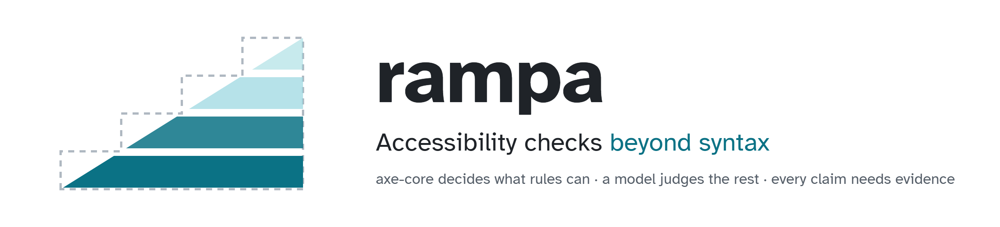
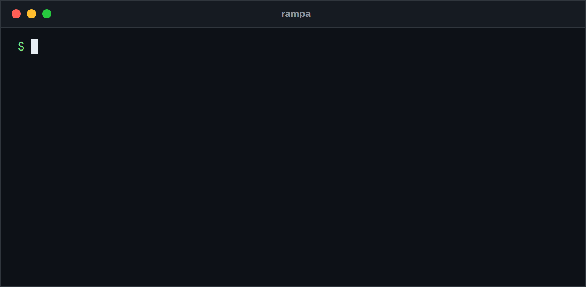

<div align="center">

<picture>
  <source media="(prefers-color-scheme: dark)" srcset="docs/media/banner-dark.png">
  
</picture>

[](https://github.com/guilhermebsantiago/rampa-cli/actions/workflows/ci.yml)
[](LICENSE)


**[Quick start](#quick-start)** · **[What it checks](#what-it-checks)** · **[Usage](#common-usage)** · **[How it compares](#how-it-compares)** · **[Evaluation](#evaluation)** · **[Docs](docs/)**

<picture>
  <source media="(prefers-reduced-motion: reduce)" srcset="docs/media/intro.png">
  
</picture>

</div>

**Rampa is an open-source WCAG accessibility checker for the command line.** It runs [axe-core](https://github.com/dequelabs/axe-core), then asks a language model, one WCAG 2.2 success criterion at a time, about what rules cannot decide: whether an image's alt text describes it, a page title names the page, a link says where it goes and matches where it leads, a heading or label describes its content, a form field identifies what it collects, a field's label is visible, and the language attributes match the text. A finding is kept only when the element it cites exists and the text it quotes is in it. It runs on a local model through Ollama or on any major provider, it is measured against the W3C ACT test cases, and it works where you do: in a terminal, in CI with SARIF and pull request comments, inside Playwright tests, and for coding agents over MCP. Site: [rampa.guilhermebs.com.br](https://rampa.guilhermebs.com.br) ([em português](https://rampa.guilhermebs.com.br/pt/)).

## Why

Automated accessibility checkers are good at what attributes and styles can prove. Ask them about meaning and they pass: axe-core passes `` because it has an `alt`, and a person using a screen reader hears "img-1". Rampa keeps the deterministic engine for everything rules can decide, sends a model only the residue, and drops every claim whose evidence is not on the page. On the small shop page in [`examples/store`](examples/store/before.html):

| Before | axe-core | Rampa | After |
| --- | :---: | --- | --- |
| `alt="IMG_2034.jpg"` on the picture of a mug | passes | file name or placeholder | `alt="Blue ceramic mug"` |
| `alt="Ceramic coffee mug"` on the picture of an umbrella | passes | describes something the image does not show | `alt="Red rain umbrella"` |
| `<title>Untitled document</title>` | passes | says nothing about the page | `New arrivals \| Corner Store` |

[docs/how-it-works.md](docs/how-it-works.md) has the whole example, with Rampa's terminal output, and the pipeline behind it.

> [!IMPORTANT]
> Rampa never says a page is accessible. It reports what was checked and what was not. No automated tool replaces a manual audit or testing with disabled people.

*Rampa* is Portuguese for ramp: the structure that turns a staircase into a way in for everyone.

## Quick start

You need Node.js 22.12+, Chrome or Edge (or `npx playwright-core install chromium`), and a model: [Ollama](https://ollama.com) or LM Studio locally, or a key for any major provider (see [Models](#models)).

```sh
npm install --global rampa-cli              # or run it once: npx rampa-cli check <url>

ollama pull gemma4:12b                       # the default model: local, free, and it has vision
rampa doctor                                 # checks Node, browser, axe-core, models and keys
rampa check https://example.com
```

With a hosted model instead, put its key in the environment or in a `.env` file in the working directory:

```sh
export OPENAI_API_KEY=...                    # never in the config file
rampa check https://example.com --model openai:gpt-6-luna
```

The package is [`rampa-cli`](https://www.npmjs.com/package/rampa-cli) on npm (the name `rampa` alone is too close to `ramda`); the command it installs is `rampa`.

## What it checks

Every report gives each of the 55 WCAG 2.2 A/AA criteria a status: failures, needs review, no failure found, no applicable content, or not checked. Never "passed" ([WCAG 2.2](docs/wcag-2-2.md); `--wcag 2.1` for the older target).

**Judged by a model.** axe-core keeps what rules can decide; the model sees only the rest, with the image as rendered when the criterion needs vision.

| Criterion | Rampa judges whether | An example axe-core passes |
| --- | --- | --- |
| [1.1.1 Non-text Content](docs/criteria.md#111-non-text-content) | the alternative serves the image's purpose | `alt="img-1"` on a photo of a dog |
| [1.3.5 Identify Input Purpose](docs/criteria.md#135-identify-input-purpose) | a field for the user's own data names its purpose | an email field with no `autocomplete` |
| [1.4.5 Images of Text](docs/criteria.md#145-images-of-text) (on request) | an image's text could be real text | a banner that is a picture of a sentence |
| [2.4.2 Page Titled](docs/criteria.md#242-page-titled) | the title describes the page | `<title>Untitled document</title>` |
| [2.4.4 Link Purpose](docs/criteria.md#244-link-purpose-in-context) | text, context and destination say where the link goes ([details](docs/link-purpose.md)) | a lone "Click here"; "Pricing" that opens a blog post |
| [2.4.6 Headings and Labels](docs/criteria.md#246-headings-and-labels) | a heading describes its content; a label says what to enter | "Section 2" over reviews, "Field 1" on an email field |
| [3.1.1 Language of Page](docs/criteria.md#311-language-of-page) | `lang` is the page's main language | `lang="en"` on a page in Portuguese |
| [3.1.2 Language of Parts](docs/criteria.md#312-language-of-parts) | each passage is in the language it declares | a Dutch review marked `lang="es"` |
| [3.3.2 Labels or Instructions](docs/criteria.md#332-labels-or-instructions) | the name is visible, and an enforced pattern is explained | a field named only by `aria-label` |

Eight run by default, 1.4.5 on request. Five experimental modules (1.3.1, 1.3.2, 1.3.3, 2.5.3, 3.3.1) run only with `--criteria`, and eight more ask a model about what a probe recorded ([criteria.md](docs/criteria.md)). On 2.4.2, 2.4.4, 2.4.6 and 3.3.2, a model's fail is a finding only when a fact Rampa checks supports it, and a 1.1.1 claim that rests on the model's reading of the picture must survive a second pass; anything else is a suggestion to review, never a failure ([why](docs/how-it-works.md#what-it-judges)).

**Around the judgment.** Rules, probes and site criteria are experimental: until people have reviewed enough of their findings, they report below the default threshold, where `--verbose` lists them without failing the build.

- **Rules:** deterministic checks axe-core does not make, such as placeholder alt text, a viewport that blocks zoom and contrast measured from pixels ([rules.md](docs/rules.md)).
- **Probes:** `--probe <kinds>` drives the page (keyboard, layout, hover, media and 17 more kinds) behind a network guard that lets only GET, HEAD and OPTIONS through ([probes.md](docs/probes.md)).
- **Site criteria:** 2.4.1, 3.2.3 and 3.2.6 across the pages of a `--crawl` or `--sitemap` ([site-criteria.md](docs/site-criteria.md)).
- **Cognitive profile:** `--profile cognitive` adds advisories from the W3C COGA guidance and GAIA, never WCAG failures ([cognitive-profile.md](docs/cognitive-profile.md)).
- **Apps and screenshots:** Android over adb, iOS from XCUITest exports, and text contrast measured on a PNG ([Android](docs/android.md), [iOS](docs/ios.md), [screenshots](docs/image-surface.md)).

## Common usage

```sh
rampa check https://example.com                     # a live page
rampa check ./dist                                  # every .html file in a folder
rampa check page.html --no-llm                      # the deterministic baseline only
rampa check page.html --criteria 1.1.1              # one criterion
rampa check page.html --sarif r.sarif --markdown r.md --html r.html   # more reports from one run
rampa check page.html --fail-on AA                  # exit 1 only for Level A and AA findings
rampa check page.html --fast                        # the preset for CI and pre-commit hooks
rampa check https://example.com --crawl --max-pages 20                # a whole site, shared components once
rampa check page.html --locale pt-BR                # report in Portuguese
```

Exit codes: `0` no confirmed failure, `1` a confirmed failure, `2` the run could not check ([details](docs/output-formats.md#exit-codes-and---fail-on)). Other commands set a project up (`rampa init`), keep known findings out of the way (`baseline`, `waive`), measure models (`eval`, `compare`), serve coding agents (`mcp`) and check the setup (`models`, `doctor`). Every command and option, and the config file, are in [docs/cli.md](docs/cli.md).

## Use it where you work

- **GitHub Actions:** `uses: guilhermebsantiago/rampa-cli@v0.1.1` (a release tag; `@main` moves with every merge): SARIF to code scanning and one sticky pull request comment ([guide](docs/github-action.md)).
- **Reports:** SARIF, Markdown, single-file HTML and JSON, with `file:line` for local pages ([formats](docs/output-formats.md)).
- **Pre-commit:** pre-commit, Husky, lint-staged or Lefthook, on staged `.html` files ([guide](docs/pre-commit.md)).
- **Playwright:** `await expect(page).toPassRampa()` from `rampa-cli/playwright`, on a page or one component ([guide](docs/playwright.md)).
- **Storybook:** the test runner's `postVisit` hook, one story at a time ([guide](docs/storybook.md)).
- **Coding agents:** `rampa mcp` for Claude Code, Cursor, VS Code and others: check, fix, check again ([guide](docs/mcp.md)).
- **Your own code:** `import { check } from 'rampa-cli'` ([API](docs/api.md)).
- **Whole sites:** `--crawl` or `--sitemap`, robots.txt respected ([crawl](docs/crawl.md)); logins, phones and dark mode ([browser options](docs/browser-options.md)).
- **Existing codebases:** a baseline so CI fails only on new findings, and waivers with reasons and expiry ([adoption](docs/adoption.md)).
- **Evaluation runs:** explore them case by case in [Rampa Lab](https://rampalab.guilhermebs.com.br/); files stay in your browser.

## Models

Pass `--model provider:model`, set `RAMPA_MODEL`, or let Rampa pick: a local Ollama model first, then the first provider with a key.

- **Local:** `ollama:gemma4:12b`, the default, is free and has vision. On an RTX 5060 Ti (16 GB) a real page took 165 to 292 s, or 74 to 103 s with `--fast`, against 5 to 8 s with no model ([performance](docs/performance.md#three-real-pages)).
- **Hosted:** `openai:gpt-6-luna` and `anthropic:claude-haiku-5-5` cost US$ 0.10 per million input tokens and 0.50 per million output; the report counts its calls and tokens and estimates the price.
- **Every provider**, with its key and price, and how to choose a model per criterion with `rampa eval`: [docs/models.md](docs/models.md).

## How it compares

Rampa and five other free checkers ran on the same 856 W3C ACT test cases (284 of them failed examples) and 96 corrupted pairs, in the same browser, scored the same way, on 2026-10-12:

| Tool | Failed examples caught | Precision | Corrupted pairs told apart |
| --- | :---: | :---: | :---: |
| axe-core 4.14 | 178 (0.63) | 0.92 | 0 of 96 |
| Siteimprove Alfa 0.119 | 182 (0.64) | 0.87 | 0 of 96 |
| QualWeb 0.9 | 190 (0.67) | 0.72 | 4 of 96 |
| IBM Equal Access 4.0 | 162 (0.57) | 0.69 | 0 of 96 |
| Pa11y 10, axe runner | 166 (0.58) | 0.81 | 0 of 96 |
| Pa11y 10, HTML_CodeSniffer | 53 (0.19) | 0.54 | 2 of 96 |
| **Rampa, no model** | 178 (0.63) | 0.93 | 0 of 96 |
| **Rampa + Gemma 4 12B** | **201 (0.71)** | **0.92** | **58 of 96** |

Caveats: Rampa's prompts were tuned on these test cases, and all of its gain is on rules it was tuned on; the pairs are its own design, and 16 of its 58 count only because their words are on its lists of generic text. Method, intervals and every table: [docs/benchmark.md](docs/benchmark.md).

## Evaluation

`rampa eval` scores axe-core alone and with the judgment layer on the W3C ACT test cases and corrupted pairs ([docs/evaluation.md](docs/evaluation.md)). The prompts were tuned on those small pages, so real pages are the measure that counts:

- **Held out.** In the [fifth real-page study](docs/studies/real-pages-2026-10-round5.md), on 24 pages the code had not seen, with Gemma 4 12B at the default threshold, 0.83 of the judged findings on the test half were real failures (20 of 24 decided, Wilson 95% 0.64–0.93), and 0.81 over all 24 pages (51 of 63). Against the fourth study's test half (0.54), the rule fixed in advance reads that as no measurable change.
- **Beyond axe-core.** None of the 146 true judged findings on studies 2 to 5 is a failure axe-core reports ([notes](docs/studies/notes-added-over-axe.md)); on the fifth study's pages they came with about one false finding for every four true ones.
- **In-sample only.** The P1 and P2 fixes since then (card headings for generic links, menu toggles, identical alternatives confirmed together) were measured only on the pages they were chosen from ([notes](docs/studies/notes-precision-p1p2.md)).
- **Labels** come from two Claude agents, pending review by a person. Each study is one run and measures precision, not what Rampa missed.

## Principles

- **Never say "accessible."** Every report lists what was checked, what was judged, and what nobody checked.
- **Verification is mandatory.** A model claim without evidence that checks out never reaches a person.
- **False positives are a constraint, not a metric.** Noise is what makes teams switch a tool off; confidence thresholds and waivers are part of the design.
- **Reproducible.** Model, prompt version and date are recorded; the same input gives the same verdict from the cache.
- **Not an overlay.** Rampa runs in development and CI, never in production pages.
- **Private by choice.** With Ollama or LM Studio, nothing leaves your machine. There is no telemetry.
- **No lock-in.** The same judgment runs on a local model or on any major provider, and `rampa eval` measures which model to trust for each criterion.

What is built and what comes next: [docs/roadmap.md](docs/roadmap.md).

## Development

```sh
pnpm install
pnpm typecheck
pnpm test        # unit tests; the browser tests run when Chrome or Edge is available
pnpm build       # dist/ and schema/
node dist/cli.mjs check examples/store/before.html   # the example page, from the build
pnpm media       # re-renders every image in docs/media from the real CLI
```

During development, `node src/cli.ts` runs the TypeScript sources directly. [`demo/`](demo/) has a guided walkthrough and a Fedora setup script; with `MODO=offline` it replays recorded snapshots and judgments, with no browser and no model. Issues and pull requests are welcome; start with [CONTRIBUTING.md](CONTRIBUTING.md). To report a vulnerability, see [SECURITY.md](SECURITY.md).

<details>
<summary><b>Em português</b></summary>
<br>

O Rampa verifica acessibilidade além da sintaxe. Ele roda o axe-core e manda só o resíduo que o axe não sabe decidir para um modelo, um critério WCAG por vez, e descarta toda alegação sem evidência conferível na página. No exemplo clássico, `alt="img-1"` numa foto de cachorro passa no axe-core porque o atributo existe; o Rampa olha a imagem, aponta o placeholder e sugere um texto alternativo no idioma da página.

Use `--locale pt-BR` para o relatório em português. O julgamento roda num modelo local (Ollama ou LM Studio) ou nos grandes provedores, como OpenAI, Anthropic, Google, Azure, Bedrock, Vertex e Mistral; `rampa models` mostra o que está pronto na sua máquina. O Rampa nunca declara uma página acessível e não substitui auditoria manual nem teste com pessoas com deficiência.

</details>

## License

[MIT](LICENSE). Third-party material:

- [axe-core](https://github.com/dequelabs/axe-core) (MPL-2.0) is a dependency, loaded unmodified from `node_modules`.
- The prompts quote short normative passages of [WCAG 2.1](https://www.w3.org/TR/WCAG21/) and [WCAG 2.2](https://www.w3.org/TR/WCAG22/), Copyright © W3C, used under the [W3C Document License](https://www.w3.org/copyright/document-license/).
- The [W3C ACT test cases](https://act-rules.github.io/pages/license/) are downloaded at run time; the test pages are not redistributed. Run outputs kept in this repository (`docs/models/runs/`, `bench/results/`, `test/fixtures/runs/`) quote test case titles, addresses and short excerpts of the pages under the W3C license; [NOTICE](NOTICE) has the notice.
- The word lists in `src/rules/words/` (used to find letter-spaced words, WCAG F32) are the most frequent lower-case words in [Tatoeba](https://tatoeba.org)'s sentences, licensed [CC BY 2.0 FR](https://creativecommons.org/licenses/by/2.0/fr/); `scripts/word-lists.py` rebuilds them and [docs/rules.md](docs/rules.md) records the export used.
- The illustrations in `examples/` were drawn for this project and are covered by its MIT license.
