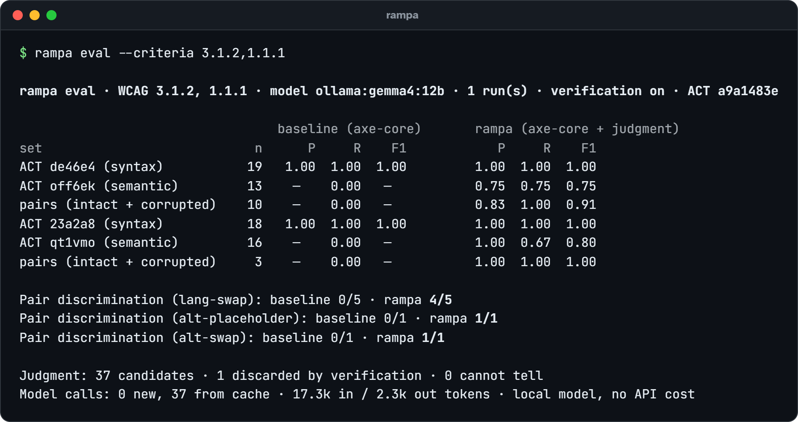

# Evaluation

How well Rampa's judgment works, on the W3C ACT test cases and corrupted pairs that `rampa eval` runs and on the real pages the [studies](studies/) measure. First where the real-page measurement stands, then the test-case evaluation, then the real-page studies one by one. How Rampa compares with other checkers on the same test cases is in [benchmark.md](benchmark.md).

## Where it stands

Written on 2026-10-29, at `14d91ee`. Real pages are what a user meets, and on them the numbers are lower than on the test cases.

- **Held out.** The [fifth real-page study](studies/real-pages-2026-10-round5.md) ran the code of 2026-10-28 (`b759128`) with Gemma 4 12B on 24 public pages none of its fixes had seen. At the default threshold, 0.83 of the judged findings on its test half were real failures (20 of 24 decided; Wilson 95% 0.64–0.93, page bootstrap 0.62–1.00), the pre-registered primary measure; 0.80 on its dev half (31 of 39) and 0.81 over all 24 pages (51 of 63, 0.70–0.89). Against the fourth study's test half (0.54, 14 of 26) the difference is +0.29, which, by the rule fixed in advance that needs both of its intervals above 0, is no measurable change.
- **What it adds over axe-core.** None of the 146 true judged findings on the second to fifth studies' 96 pages is a failure axe-core reports on the same snapshot, and 90 of them are under a criterion axe-core failed nothing on, on that page ([notes](studies/notes-added-over-axe.md)). On the fifth study's pages they came with about one false finding for every four true ones. The rows of the second to fourth studies are an in-sample replay.
- **Since then, in-sample only.** P1 (a card's heading completes a generic link text, and a menu toggle is not a link to judge) and P2 (identical alternatives on one page confirmed together) were chosen on the second to fourth studies and the fifth study's dev half, and measured only there ([notes](studies/notes-precision-p1p2.md)): the fifth study's dev half went from 31 true and 8 false findings to 37 and 0. Its test half had no finding either change could move, so it stays at 20 and 4 and measures neither. P3 (a social network's icon named for the network) and P4 (a shared link text that is its destination's heading or title), with a refinement of P1 (a generic heading is no card heading), followed the same way ([notes](studies/notes-precision-p3p4.md)): 3 more false findings left, none true, and over the second to fourth studies and the fifth study's dev half the judged findings went from 132 true and 18 false (0.88) to 132 and 15 (0.90, 0.84–0.94). These are not held-out numbers; a round on fresh pages is what would measure them.
- **Who labelled.** Every label is a pre-annotation by two Claude agents of one model family, an auditor and a skeptic, pending review by a person ([plan](studies/human-review-plan.md)). Each study is one run and measures precision only: the pages were not audited for what Rampa missed.

## The W3C ACT test cases and corrupted pairs

`rampa eval` measures, on the same pages, axe-core alone and axe-core with the judgment layer, for every criterion that has W3C ACT test cases, plus corrupted pairs for each judged criterion:



| Criterion | ACT set | Tests | Cases | axe-core P / R | Rampa P / R / F1 |
| --- | --- | --- | :---: | :---: | :---: |
| 1.1.1 | 23a2a8, image has a name | syntax | 18 | 1.00 / 1.00 | 1.00 / 1.00 / 1.00 |
| 1.1.1 | qt1vmo, name describes the image | meaning | 16 | — / 0.00 | 1.00 / 1.00 / 1.00 |
| 1.3.5 | 73f2c2, autocomplete is valid | syntax | 30 | 1.00 / 1.00 | 0.83 / 1.00 / 0.91 |
| 1.4.5 | 0va7u6, image contains no text | meaning | 15 | — / 0.00 | 1.00 / 0.60 / 0.75 |
| 2.4.2 | 2779a5, page has a title | syntax | 12 | 1.00 / 1.00 | 0.50 / 1.00 / 0.67 |
| 2.4.2 | c4a8a4, title describes the page | meaning | 6 | — / 0.00 | 1.00 / 1.00 / 1.00 |
| 2.4.4 | c487ae, link has a name | syntax | 28 | 1.00 / 1.00 | 1.00 / 1.00 / 1.00 |
| 2.4.4 | 5effbb, link in context is descriptive | meaning | 18 | — / 0.00 | 0.86 / 1.00 / 0.92 |
| 2.4.4 | fd3a94, links with the same name serve the same purpose | meaning | 24 | — / 0.00 | 0.58 / 0.88 / 0.70 |
| 2.4.6 | b49b2e, heading is descriptive | meaning | 12 | — / 0.00 | 0.80 / 1.00 / 0.89 |
| 2.4.6 | cc0f0a, field label is descriptive | meaning | 16 | — / 0.00 | 1.00 / 0.83 / 0.91 |
| 3.1.1 | b5c3f8 and bf051a, page has a valid lang | syntax | 11 | 1.00 / 1.00 | 1.00 / 1.00 / 1.00 |
| 3.1.1 | ucwvc8, lang matches the page | meaning | 14 | 0.00 / 0.00 | 0.50 / 1.00 / 0.67 |
| 3.1.2 | de46e4, valid lang on parts | syntax | 19 | 1.00 / 1.00 | 1.00 / 1.00 / 1.00 |
| 3.1.2 | off6ek, lang matches the text | meaning | 13 | — / 0.00 | 0.80 / 1.00 / 0.89 |

3.3.2 has no ACT rule of its own; it is measured on pairs only.

Corrupted pairs, a passing page and a copy broken on purpose: axe-core tells **none of 71** apart, Rampa **66**. By kind: `alt` 2 of 2; `autocomplete` removed 8 of 9 and swapped for other data 6 of 7; text pictured as an image 4 of 4; title 3 of 3; link text made generic 10 of 11 and pointed elsewhere 10 of 10; headings and labels 8 of 9; page `lang` 4 of 4; `lang` on parts 4 of 5; labels moved off the screen 7 of 7.

Run on 2026-10-09 at 04:30 UTC: axe-core 4.14.0, Gemma 4 12B on a local GPU, reasoning off, one run, ACT test cases `a9a1483e`. 271 judgments, 4 dropped by verification, no API cost. The comparison of four local models in [models.md](models.md#four-local-models-measured) (320 of 343 cases, 71 of 79 pairs) is a later run, on 2026-10-10, on a different set: the eight default criteria without 1.4.5, with the hidden-image set e88epe and two more kinds of pairs (`lang-drop` and `label-unseen`), so its totals do not match this table's. Read the numbers with these caveats:

- **The prompts were tuned on these cases.** Every criterion added since the first run had its prompt and context adjusted after reading its errors here, without copying the test pages into the prompts. Until fresh pages confirm them, the numbers say "the pipeline works", not more.
- **Some low precisions are scoring, not judgment.** 2779a5 only checks that a title exists, and its passing pages are titled "Title of the page."; Rampa says those describe nothing, which is right for 2.4.2. On ucwvc8 every passed and failed example is right; the false positives are pages the rule calls inapplicable, four of which axe-core fails for a missing or invalid `lang`. On 73f2c2 the two false positives are `autocomplete=""` on a username field, which is a real 1.3.5 failure that the rule leaves out.
- **Where Rampa is weak.** fd3a94 asks whether links that share a name lead to equivalent places, and ACT accepts copies of a page and links "ambiguous to everyone" that Rampa reports. On 1.4.5, Gemma reads "WCAG Rocks" as a logo, and Rampa follows the WCAG Understanding document, not the ACT case, on an image of text shown next to the same real text.
- **Real pages are noisier than test cases**: see [Real pages, study by study](#real-pages-study-by-study).
- **Small samples, one run.** Read these as a working pipeline, not as a result. Wilson intervals are in each run's `summary.json`, and `rampa compare` puts two runs side by side.

The first run, on 2026-10-07 with only 1.1.1 and 3.1.2, had recall 0.67 on qt1vmo and 0.75 on off6ek. An error analysis showed the misses never reached a model: Rampa did not treat `<canvas>` as an image, and did not count image names from `aria-labelledby` as text. On those two criteria, `openai:gpt-6-luna` got the same numbers as Gemma in two runs with fresh calls (about US$ 0.005 per run).

```sh
rampa eval --no-llm                 # baseline only
rampa eval                          # baseline vs judgment, the default criteria
rampa eval --criteria 1.4.5         # one criterion
rampa eval --no-verify              # ablation: what verification is worth
rampa eval --criteria 3.1.2 --runs 5   # variance between runs
rampa compare .rampa/runs/<a> .rampa/runs/<b>   # two runs, case by case
```

The [W3C ACT test cases](https://www.w3.org/WAI/standards-guidelines/act/rules/) are downloaded at run time and their SHA-256 is recorded with every run. Corrupted pairs follow [López-Gil & Pereira (2025)](https://doi.org/10.1007/s10209-024-01108-z): break a passing case on purpose and check that the verdict flips. An `alt` becomes `img-1`, a `lang` becomes another valid language, the title becomes "Welcome", headings become "Part 1" and labels "Entry 1", a link says "Check it out". Of those words, only `img-1` appears in a prompt, as one of 1.1.1's examples of a placeholder; "Welcome", "Part 1" and "Check it out" are on lists of generic text that Rampa's current code uses on titles, headings and links, added after the corruptions were written ([benchmark.md](benchmark.md#caveats)). A tool that gives both versions the same verdict is not judging.

## Real pages, study by study

**Real pages are noisier than test cases.** The [real-page study](studies/real-pages-2026-10.md) (24 public pages; each finding labelled by two Claude agents, an auditor and a skeptic told not to read each other's work, whose mistakes are likely correlated since they are one model family; a pre-annotation pending human review) found precision of 0.13 on the dev pages and 0.12 on the test pages across all judged findings: 1.3.5 held up, 1.1.1 was weak, and 2.4.2, 2.4.4 and 2.4.6 were almost all false positives. After fixes taken from the dev pages' examples, a [re-measurement on the test pages](studies/real-pages-2026-10-remeasure.md), whose findings had been read when the study described its patterns, so not a clean held-out measurement, found precision of 0.38 at the default threshold (0.12 before) and 0.19 counting low-confidence findings: most of the gain comes from reporting 2.4.4 and 2.4.6 claims about ordinary text below the threshold, not from better judgments, and those two criteria still had no true failure among their findings. Since then, a fail on those two criteria is a finding only when a checked fact supports it, and the rest are the model's suggestions for review ([notes](studies/notes-244-246.md)); a [second study on 24 fresh pages](studies/real-pages-2026-10-fresh.md), the held-out measurement, labelled the same way and run on the code just before that change, found precision of 0.42 on its dev pages and 0.35 on its test pages at the default threshold (0.26 and 0.14 counting low-confidence findings): 1.3.5 was 11 of 11, 1.1.1 about a third, and 2.4.4 and 2.4.6 still wrong almost every time, while the experimental pixel-contrast rule was 60 of 60. [Judged again with the change](studies/real-pages-2026-10-fresh.md#after-the-244246-change), its test pages gave 0.38 at the default threshold (no measurable change from 0.35) and 0.38 counting low-confidence findings (0.14 before): 2.4.4 and 2.4.6 went from 97 findings with 1 true failure to 13 with 5, and the rest are now suggestions, almost all of them wrong too. A [third study on 24 more pages](studies/real-pages-2026-10-round3.md), held out from every fix since, found 0.43 on its dev pages and 0.24 on its test pages at the default threshold (0.42 and 0.24 counting low-confidence findings), so no gain over the second study's 0.49 and 0.38: 50 of the test pages' 103 judged findings were 2.4.4 false positives on one page, 1.1.1 was 0.26 and 0.50, and the probes were right 116 times out of 121. A [probe over all three studies' labels](studies/notes-precision-probe.md) then found that three causes held 84% of the false positives (that one page, captured without its stylesheets; the 1.1.1 claim that an alternative describes something the image does not show; the functional-image claim), and five changes followed: a guard for an unstyled capture and for a layer over the viewport, a one-word second pass over the 1.1.1 claims that rest on the model's reading, three claims moved to suggestions, three 1.1.1 facts, and a safer destination reader. Run on the same recorded snapshots, in-sample, they give study 3's dev half 0.83 and study 2's halves 1.00 and 0.77, 0.84 pooled on the findings a recording can replay (the unstyled page stays on its recording), with 4 of 72 true positives lost; the W3C 1.1.1 cases keep precision and recall 1.00. Those numbers were measured on the pages the changes were chosen from, so they are an upper bound until a pre-registered fourth round on fresh pages. That [fourth study](studies/real-pages-2026-10-round4.md), on 24 more pages none of the changes had seen and labelled the same way (two Claude agents, pending human review), found 0.54 on its test pages at the default threshold (14 of 26, 0.35–0.71), up from the third study's 0.24 by the rule it fixed in advance and no measurable change from the second study's 0.38, but 0.19 on its dev pages, which the code had not seen either, because one store page gave 50 false 2.4.4 findings, so that over all 24 pages precision was 0.29, the same as the third study's; the second pass removed 12 of the 17 false 1.1.1 reading claims and 1 of the 4 true ones, and 1 of 39 sampled suggestions was a real failure. Over the second to fourth studies, 108 of the 129 false findings sat on three pages, each a burst with its own cause; [four fixes](studies/notes-precision-fixes.md) followed (links told apart by the list items they are nested in, a page with no style at all and the default body look read as unstyled, the 1.1.1 second pass at 0.99, 2.4.2 and 3.3.2 fails with no checked fact as suggestions). Replayed on those 72 recorded pages with their rules frozen first, they move the judged findings from 95 true and 129 false (0.42) to 95 and 16 (0.86, 0.78–0.91), with no true finding lost, and from 0.76 to 0.83 counting each burst of one claim on one page as one finding. Those pages were read to choose the fixes, so these numbers are in-sample, an upper bound until a fifth round on fresh pages. That [fifth study](studies/real-pages-2026-10-round5.md), on 24 more pages none of the fixes had seen and labelled the same way (two Claude agents, pending human review), found 0.83 on its test pages at the default threshold (20 of 24 decided, Wilson 0.64–0.93, page bootstrap 0.62–1.00), 0.80 on its dev pages and 0.81 over all 24 (51 of 63, 0.70–0.89), so about 95% of the in-sample 0.86 held; against the fourth study's test half (0.54) the difference is +0.29, above 0 by Newcombe's interval but not by the page bootstrap's, so by the rule fixed in advance, which needs both, there is no measurable change. No page held a burst of false findings larger than 7, and the second pass removed 13 false and 6 true 1.1.1 claims.
