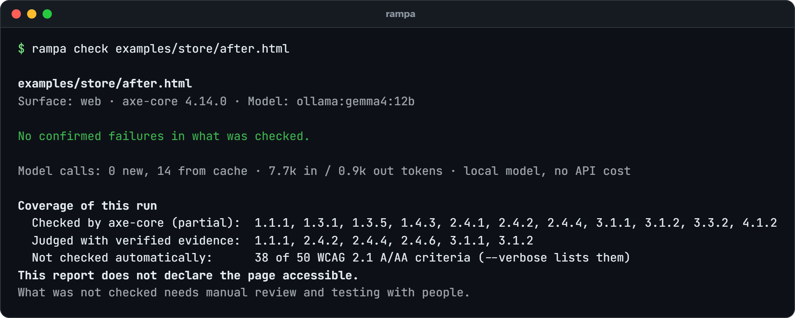
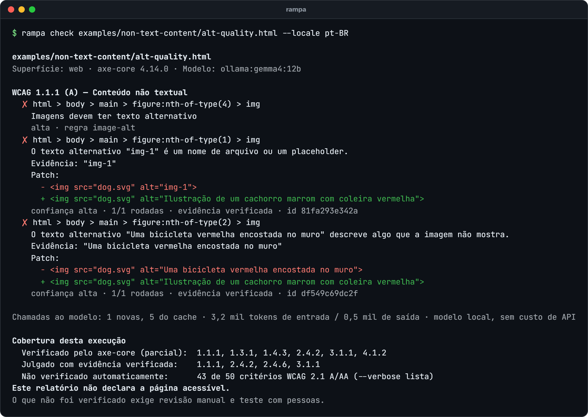
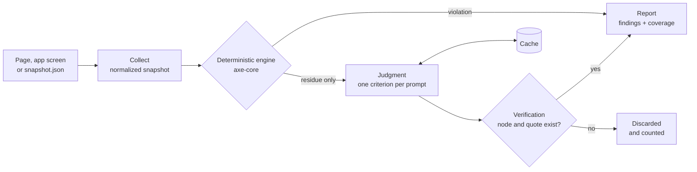

# How Rampa works

Why Rampa adds judgment to a rule engine, what it judges and what else it checks, a page before and after, and how a check runs. The [README](../README.md) has the short version; [criteria.md](criteria.md) describes each judged criterion in detail.

## Why

Automated accessibility checkers are good at what attributes and styles can prove. Ask them about meaning and they pass:

```html

```

axe-core reports that this image passes, because it has an `alt`. A person using a screen reader hears "img-1". The same goes for a page titled "Untitled document", a link that says "Click here", a heading "Section 2" over customer reviews, a field labeled "Field 1", or a Dutch quote marked as Spanish: valid syntax, wrong meaning. In February 2026, 95.9% of the top million home pages had detectable WCAG failures ([WebAIM Million](https://webaim.org/projects/million/)), and that counts only what tools can detect.

Rampa keeps the deterministic engine and adds a judgment layer for that residue:

<table>
<tr>
<td width="33%" valign="top">

**Deterministic first**

axe-core decides everything rules can decide. Its findings go straight to the report, with no model involved.

</td>
<td width="33%" valign="top">

**Judgment on the residue**

A model sees only what the engine could not decide, one WCAG criterion at a time, with the image as it renders when the criterion needs vision.

</td>
<td width="33%" valign="top">

**Evidence or nothing**

Every claim must cite a node and a quote that exist on the page. Claims that do not check out are dropped and counted.

</td>
</tr>
</table>

> [!IMPORTANT]
> Rampa never says a page is accessible. It reports what was checked and what was not. No automated tool replaces a manual audit or testing with disabled people.

*Rampa* is Portuguese for ramp: the structure that turns a staircase into a way in for everyone.

## What it judges

Fourteen WCAG success criteria have a judgment module. Eight run by default and 1.4.5 runs when you ask for it; the table lists those nine. The other five are experimental and run only with `--criteria`: 1.3.1 (text styled as a heading), 1.3.2 (reading order the rules could not verify), 1.3.3 (instructions that rely on shape or position), 2.5.3 (a visible label not tied to its field) and 3.3.1 (error messages the page shows). For each, axe-core keeps the part rules can decide, and the model only sees the rest. Eight more modules ask a model one narrow question about what a probe recorded, and run only when that probe ran (`--probe`) and left something to ask: 2.1.1, 2.1.4, 2.2.1, 2.4.3, 2.5.1, 3.2.2, 3.3.8 and 4.1.3. Most of them can only clear their probe rule's finding, never make one. [criteria.md](criteria.md) describes each module: its context, verification and limits.

> [!NOTE]
> On real pages, judgments about ordinary titles, links, headings and labels were mostly false positives in the [first real-page study](studies/real-pages-2026-10.md): with Gemma 4 12B, precision was 0 of 55 on 2.4.4 and 0 of 45 on 2.4.6, while the W3C test cases scored much higher. So for 2.4.2 a finding keeps its confidence only when the title is generic by a fixed list ("Untitled document", "Home"), and since 2026-10-27 a title fail is a finding only for such a title, an address or a file name, or a title identical to another page of the site; any other is a suggestion. For 2.4.4 and 2.4.6, a model's fail becomes a finding only when a fact Rampa checks itself supports it: a generic text such as "Click here" or "Section 2" with no context of its own, a raw address, links that share a text and lead elsewhere from the same context, a numbered heading under no subject, a label several fields share; and, since 2026-10-23, a link text that names only a file's format ("HTML", "PDF") with nothing around it that says which document, or a "Download" in a table row whose document is a data cell, and a link to a part of this page that the page names (its id and its text share a word) while the link names none of it. Those two were added from the W3C test cases, the corrupted pairs and real dev pages, and are not yet measured on held-out pages ([notes](studies/notes-remaining-errors.md)). Every other fail is the model's *suggestion*: it is listed with the items to review, never as a failure, and the criterion's coverage says a person has to look ([why](studies/notes-244-246.md)). Since 2026-10-24, from the [precision probe](studies/notes-precision-probe.md) over all three studies' labelled findings: a 1.1.1 claim that rests on the model's reading of the picture ("describes something the image does not show"; a functional image that "does not say where the link leads") is asked again as one-word questions framed three ways and is a finding only when all three confirm it with a first-token probability of at least 0.9, 0.99 since 2026-10-27 (`--no-confirm` turns the pass off); a 2.4.6 label several fields share, a 3.3.2 claim on a collapsed or search field and a 2.4.4 raw address inside a sentence are suggestions; and a page read without its stylesheets, or under a layer that covers the viewport, is recorded as such, judged only as suggestions in the first case and measured with the layer hidden in the second. A pre-registered [fourth round](studies/real-pages-2026-10-round4.md) measured those on fresh pages. Since 2026-10-27, from its labels and the earlier studies' ([notes](studies/notes-precision-fixes.md)): links that share a text tell apart by the list items they are nested in (H81), so a menu's nested copies of its own sections are no longer "ambiguous"; a page that came with no style at all and the browser's default body look (a site serving automated browsers a stripped page) is read as unstyled too, and a stylesheet link to the page itself is no longer counted; the 1.1.1 second pass needs a probability of at least 0.99; and a 3.3.2 fail is a finding only when the label was measured as unseen or nothing visible sits beside the field. Their effect has only been measured in-sample, on the pages they were chosen from; a fifth round on fresh pages is what would measure it.

That [fifth round](studies/real-pages-2026-10-round5.md) has run since; [Where it stands](evaluation.md#where-it-stands) has its result and what changed after it.

| Criterion | axe-core checks | Rampa judges | Example it catches |
| --- | --- | --- | --- |
| 1.1.1 Non-text Content | an image has an alternative | the alternative serves the same purpose, seen against the image as rendered | `alt="img-1"` on a photo of a dog |
| 1.3.5 Identify Input Purpose | `autocomplete` values are valid | a field that collects the user's own data names its purpose with the right token | an email field with no `autocomplete` |
| 1.4.5 Images of Text (on request) | nothing | an image whose content is text that could be real text, logos excepted | a banner that is a picture of a sentence |
| 2.4.2 Page Titled | the page has a title | the title describes the page | `<title>Untitled document</title>` |
| 2.4.4 Link Purpose | a link has a name | the name, with its context and the page it really leads to, tells where the link goes ([details](link-purpose.md)) | a lone "Click here"; "Pricing" that opens a blog post |
| 2.4.6 Headings and Labels | headings are not empty, fields have a label | a heading describes the content under it; a label says what to enter | "Section 2" over reviews, "Field 1" on an email field |
| 3.1.1 Language of Page | `lang` is present and valid | `lang` is the language most of the page is written in | `lang="en"` on a page in Portuguese |
| 3.1.2 Language of Parts | `lang` values are valid | each passage is in the language it declares | a Dutch review marked `lang="es"` |
| 3.3.2 Labels or Instructions | a field has a name | the name is visible on screen, and an enforced pattern is explained | a field named only by `aria-label` |

Every finding cites the element and its current text, and verification drops any claim whose quote is not on the page. Each module has W3C ACT test cases to measure it against (see [Evaluation](evaluation.md)).

## Beyond judgment

Rampa reports against WCAG 2.2 by default (`--wcag 2.1` for the older target), and every report gives each of the 55 A/AA criteria a status: failures, needs review, no failure found, no applicable content, or not checked. Never "passed". Around the judged criteria:

| What | Checks | Guide |
| --- | --- | --- |
| Rampa rules (experimental) | Deterministic checks axe-core does not make: placeholder alt text, framework default titles, viewport zoom, the HTTP Refresh header, language switchers, table headers, layout tables, labels that name nothing, ids that hijack a name, a field's label left out of its name (2.5.3), labels that show nothing on screen, words spelled out with spaces between the letters (1.3.2), error messages on the page that are not in text or give no suggestion (3.3.1, 3.3.3), contrast measured from pixels where axe-core cannot decide (1.4.3, 1.4.11), and checks over the browser's own accessibility tree: controls with no name or no role, tab and disclosure states (4.1.2), live regions listed for 4.1.3 | [rules.md](rules.md) |
| WCAG 2.2 | 2.5.8 Target Size (experimental), the 2.2 list and honest coverage: axe-core's "incomplete" results become items to review, never "checked" | [wcag-2-2.md](wcag-2-2.md) |
| Probes (experimental, `--probe <kinds>`, off by default) | Load the page again and drive it, behind a network guard that lets only GET, HEAD and OPTIONS through. 21 kinds; `--probe all` runs eight: layout (reflow at 320 CSS px, text spacing, text cut at 200% zoom), keyboard (reachability and traps, focus visible and not obscured, change on focus, skip links pressed), hover, orientation, media (captions, alternatives, sound that plays by itself), color, states, and shortcuts, which presses every printable key on the page. The other thirteen run only when named: those that click, type, drag or swipe (links, input, toggles, status, form, pointer, parity, focus-order, gestures), auth (pastes into sign-in fields), flash, motion and variants. Only the form probe can submit, and only to an origin `--allow-submit` names | [probes.md](probes.md), with every kind and what it may do |
| Site criteria (experimental) | With `--crawl` or `--sitemap`: 2.4.1 Bypass Blocks (blocks repeated across pages with no way past them), 3.2.3 Consistent Navigation and 3.2.6 Consistent Help, across the pages of a template or a language | [site-criteria.md](site-criteria.md) |
| Cognitive profile | `--profile cognitive`: experimental advisories from the W3C COGA guidance and GAIA, a guide for autistic users: input formats that reject how people write, labels that are only a placeholder, pre-ticked paid options and unexplained abbreviations; motion that keeps running when the system asks for reduced motion, pop-ups, sound and permission requests nobody asked for, content that jumps, and paste that is blocked, from a short look at the page with no input (about 8 s, 3 s with `--fast`); long lines, justified text, tight line spacing, long passages in capitals or italics, decorative fonts, controls that show only an icon, and links that open a new window without saying so; with a model, idioms in buttons and labels, long text with no summary, and error messages that do not say how to put the problem right, as suggestions to review; plus readability measurements. Advisories are never WCAG failures and never change the exit code unless you ask, and a model's suggestion never does | [cognitive-profile.md](cognitive-profile.md) |

Experimental checks report at low confidence, below the default threshold, until enough of their findings have been reviewed by a person. `--verbose` lists them without failing the build; `--min-confidence low` promotes them to findings, which then fail the build under the default `--fail-on confirmed`. The plans behind this are in [plans](plans).

## Before and after

[`examples/store/before.html`](../examples/store/before.html) is a small shop page with the kind of problems a deterministic audit lets through. [`after.html`](../examples/store/after.html) applies the patches Rampa suggested.

| Image | Before | axe-core | Rampa | After |
| :---: | --- | :---: | --- | --- |
|  | `alt="IMG_2034.jpg"` | passes | file name or placeholder | `alt="Blue ceramic mug"` |
|  | `alt="Ceramic coffee mug"` | passes | describes something the image does not show | `alt="Red rain umbrella"` |
|  | `alt="product"` | passes | too generic | `alt="Potted plant with green leaves"` |
|  | no `alt` | **fails** | reported by axe-core | `alt="Corner Store"` |
|  | `alt="Toto, our store mascot: a smiling cartoon dog with a red collar"` | passes | passes, no false positive | unchanged |
| — | Dutch review marked `lang="es"` | passes | marked Spanish, the text is Dutch | `lang="nl"` |
| — | `<title>Untitled document</title>` | passes | says nothing about the page | `New arrivals \| Corner Store` |
| — | a lone link "Click here" | passes | does not tell where it goes | "Shipping and returns" |
| — | heading "Section 2" over the reviews | passes | says nothing about the content | "What customers say" |
| — | email field labeled "Field 1" | passes | does not say what to enter | "Email address" |
| — | the same field without `autocomplete` | passes | does not identify what it collects | `autocomplete="email"` |




The patches, as Rampa proposed them:

```diff
- 
+ 
- 
+ 
- 
+ 
- <blockquote lang="es">
+ <blockquote lang="nl">
```

A suggested `alt` is a proposal for a person to review, never a fix applied on its own: what a model says it sees cannot be checked against the page.

<details>
<summary><b>Reports in Portuguese</b> (<code>--locale pt-BR</code>)</summary>
<br>

Suggested alternatives follow the language of the page, and the report follows `--locale`.



</details>

## How a check runs

1. **Collect.** The target becomes a normalized accessibility snapshot: the accessibility tree with ARIA roles, names, languages, states and bounds, plus each image as rendered and the source markup. A URL that serves a standalone SVG document is checked too, by axe-core and the rules; an XML document the browser only shows as source is not, and the report says so ([API](api.md)).
2. **Deterministic engine.** axe-core runs on the page, and its violations go straight to the report.
3. **Judgment.** Only the residue goes to the model: what the engine reported as incomplete, passed on syntax alone, or does not check at all. One prompt per criterion, minimal context, structured JSON output.
4. **Verification.** The cited node must exist and the quoted text must be in it, or the claim is dropped and counted.
5. **Report.** Findings by criterion, a patch when possible, and the coverage of the run: what the engine checked, what was judged, and what nobody checked.



Judgments are cached by a hash of prompt, image, model and settings, so the same input never calls the model twice. `--runs k` asks k times and keeps the majority; when runs disagree, confidence drops.

## Any screen, not only the web

Criteria never read the DOM. They read the snapshot, so the core is the same for any platform. `rampa check screen.json` accepts a snapshot from any exporter that follows [`schema/snapshot.schema.json`](../schema/snapshot.schema.json): an Android view hierarchy, an iOS XCUITest export, a desktop UI Automation tree. The same 1.1.1 module judges an `alt`, a `contentDescription` or an `accessibilityLabel`. `rampa check android:` reads a device over adb and UI Automator, a Swift helper exports iOS screens from XCUITest, and `rampa check screen.png` measures text contrast where no tree exists. Each report says what its source could not show.

## Where it runs

The surfaces and integrations, each with its guide. The [README](../README.md#use-it-where-you-work) has the same list in short.

| Where | How | Guide |
| --- | --- | --- |
| GitHub Actions | `uses: guilhermebsantiago/rampa-cli` at a release tag, as in the README and the guide (`@main` moves with every merge): SARIF to code scanning and one sticky pull request comment, with each finding's patch | [github-action.md](github-action.md) |
| Reports | SARIF, Markdown for pull requests, a single-file HTML report, JSON; `file:line` for local pages | [output-formats.md](output-formats.md) |
| Pre-commit | the pre-commit framework, Husky, lint-staged or Lefthook, on staged `.html` files | [pre-commit.md](pre-commit.md) |
| Playwright tests | `import { checkPage } from 'rampa-cli/playwright'` and `await expect(page).toPassRampa()`, scoped to a component if you like | [playwright.md](playwright.md) |
| Storybook | the test runner's `postVisit` hook, one story at a time | [storybook.md](storybook.md) |
| Your own code | `import { check } from 'rampa-cli'` | [api.md](api.md) |
| Coding agents | `rampa mcp` for Claude Code, Cursor, VS Code and others: check, fix, check again | [mcp.md](mcp.md) |
| Whole sites | `--crawl` or `--sitemap`, robots.txt respected, a shared header reported once | [crawl.md](crawl.md) |
| Existing codebases | `rampa init`, a baseline so CI fails only on new findings, waivers with reasons and expiry | [adoption.md](adoption.md) |
| Android and iOS | `rampa check android:` over adb; XCUITest exports from a Swift helper | [android.md](android.md), [ios.md](ios.md) |
| Screenshots | `rampa check screen.png`: text contrast measured from pixels, nothing it cannot see | [image-surface.md](image-surface.md) |
| Choosing a model | `rampa eval` per criterion, then `rampa compare` | [models.md](models.md) |
| Exploring an evaluation | load a run folder in [Rampa Lab](https://rampalab.guilhermebs.com.br/): scores, case by case, two runs compared; files stay in your browser | |
